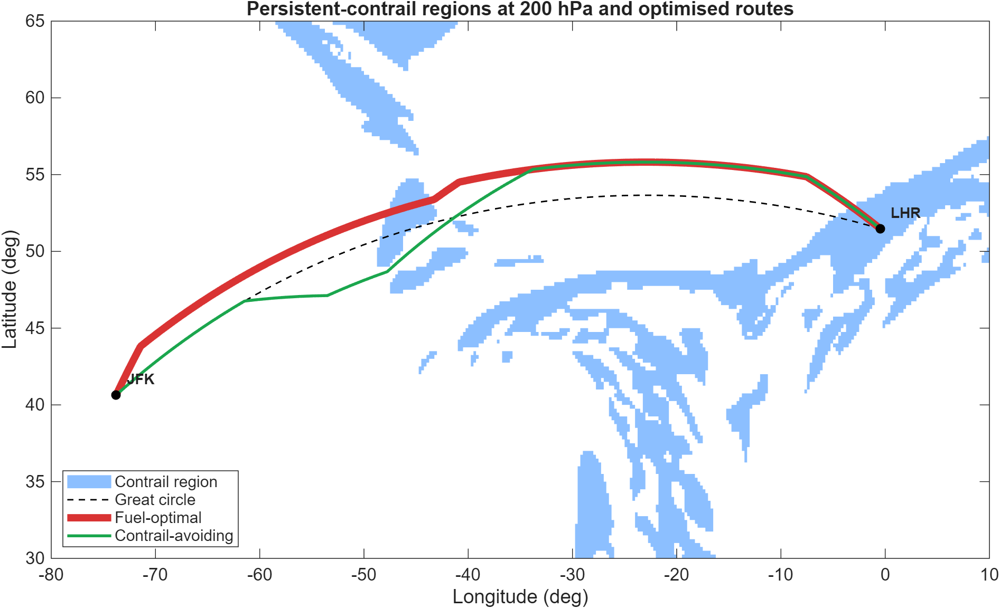
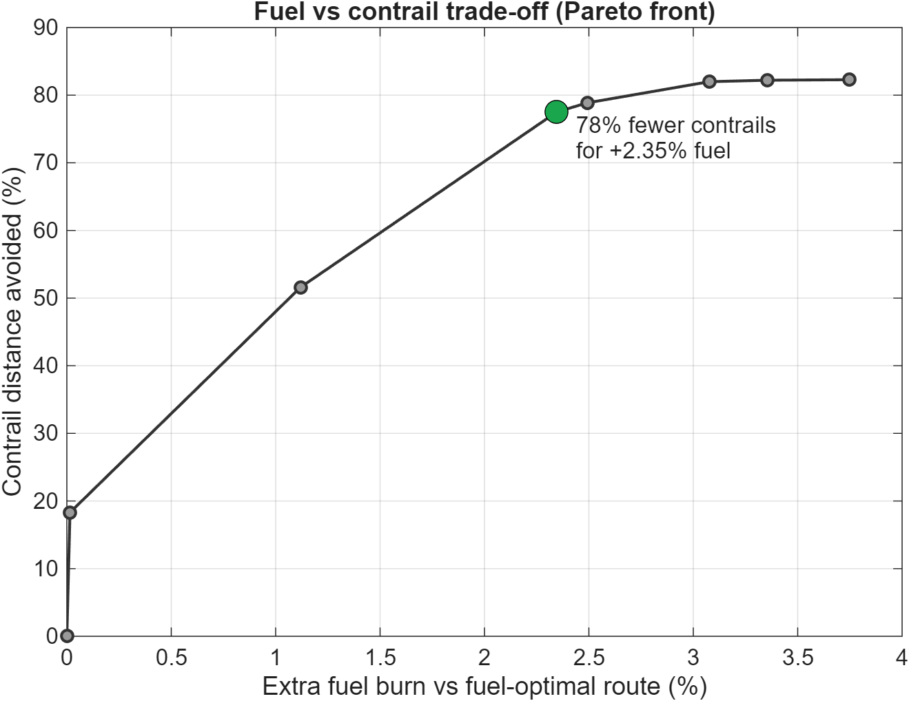
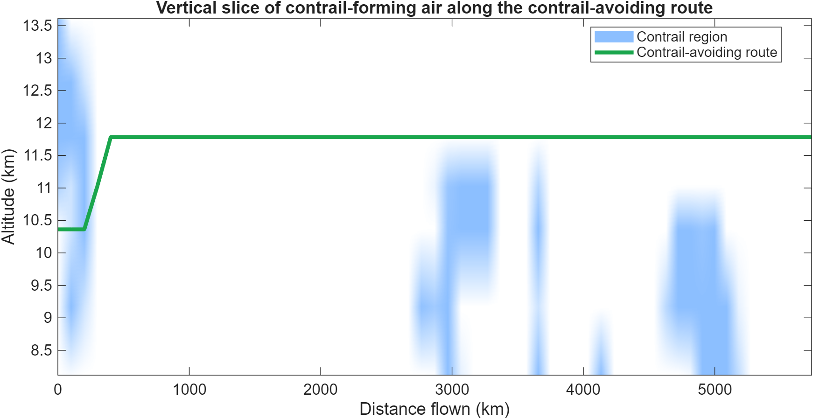

# Contrail Avoidance Optimiser (MATLAB)

Can a transatlantic flight avoid forming persistent contrails, and what would it cost in fuel?

This project models a **London Heathrow (LHR) → New York JFK** flight using real weather data. It finds routes that trade a little extra fuel for much less time flying through contrail-forming air.

## Key results (From the 1st to the 31st of January 2025, 12:00 UTC)

| Extra fuel vs fuel-optimal route | Contrail distance avoided |
|---|---|
| +0.01% | 18% |
| +1.1% | 52% |
| **+2.35%** | **78%** |
| +3.75% | 82% |

- About a fifth of contrail distance can be avoided almost for free.
- Most of the benefit comes before about 2.5% extra fuel, with sharply diminishing returns after that.
- The remaining contrail distance is mostly just after departure from London, where contrail-forming air covered every cruise altitude.

## Method

1. **Weather data:** ERA5 reanalysis (Copernicus Climate Data Store) for temperature, specific humidity and u/v winds on 7 pressure levels (150–350 hPa), over 30–65°N and 80°W–10°E.
2. **Contrail formation:** the Schmidt–Appleman criterion (Schumann, 1996) gives the threshold temperature for contrail formation.
3. **Contrail persistence:** relative humidity over ice ≥ 100% (ice-supersaturated regions), using the Murphy & Koop (2005) saturation vapour pressure.
4. **Route network:** a 3D graph of 61 points along the great circle × 13 lateral offsets (±240 km) × 4 flight levels (FL300–FL390). Each step can shift one offset sideways and/or one flight level.
5. **Fuel model:** drag polar (A350-900-like), Mach 0.85, TSFC, real headwinds and tailwinds, plus a climb penalty.
6. **Optimisation:** Dijkstra's shortest path with cost = fuel + λ × contrail distance, swept over λ to build a Pareto front.

## How to run

1. Download ERA5 hourly data on pressure levels from the [Copernicus CDS](https://cds.climate.copernicus.eu/) with these settings:
   - **Variables:** temperature, specific humidity, u- and v-component of wind
   - **Pressure levels:** 150, 175, 200, 225, 250, 300, 350 hPa
   - **Area:** North 65, South 30, West −80, East 10
   - **Format:** NetCDF4
2. Put the `.nc` file in the same folder as `contrail_avoidance.m`, and set `dataFile` at the top of the script.
3. Run the script in MATLAB (R2022a or newer). No toolboxes are required. The Mapping Toolbox adds coastlines if you have it.

All settings (aircraft, grid, flight levels, λ range) are in the (User settings) block at the top of the script.

## Limitations

- One day of weather data.
- Simplified aircraft model: constant mass, no step climbs, no buffet limit.
- Contrail *distance* is used, not climate impact. Daytime contrails partly cool and night-time ones only warm.
- ERA5 is known to underestimate ice supersaturation. [Humidity scaled by 10% / no humidity correction applied.]
- Extra fuel means extra CO₂ (about 3.16 kg CO₂ per kg of fuel), so the true net climate benefit needs a contrail radiative forcing model.

## Next steps

- Weight contrails by time of day and radiative forcing.
- Add mass reduction during the flight and step climbs.

## References

- Schumann, U. (1996). On conditions for contrail formation from aircraft exhausts. *Meteorologische Zeitschrift*, 5, 4–23.
- Murphy, D. M. & Koop, T. (2005). Review of the vapour pressures of ice and supercooled water for atmospheric applications. *Q. J. R. Meteorol. Soc.*, 131, 1539–1565.
- Teoh, R. et al. (2020). Mitigating the climate forcing of aircraft contrails by small-scale diversions and technology adoption. *Environmental Science & Technology*, 54(5), 2941–2950.
- Hersbach, H. et al. (2020). The ERA5 global reanalysis. *Q. J. R. Meteorol. Soc.*, 146, 1999–2049.

---
*Personal project by Yara Mustafa, MEng Aerospace Engineering student.*
